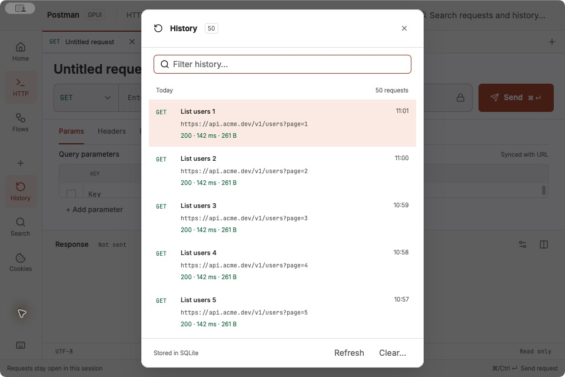

# P4.1 — History, search and shortcut help

Implements [#205](https://github.com/847850277/postman-gpui/issues/205), part of
[#194](https://github.com/847850277/postman-gpui/issues/194). The design baseline is
`prototypes/request-workspace.html` at `5ee83f11ab03958068a0bddd7353219697e3a05c`.
GPUI Kit 0.7.1 / GPUI 0.3.8 remain pinned.

## Implementation

Kit Root/Dialog owns modal layering, backdrop dismissal, focus containment and focus
restoration. Kit Input owns editing; Kit List owns selection, pointer/keyboard activation,
virtualization and scrolling. RequestFinder retains both entities and projects the existing
WorkspaceViewModel. SQLite, replay, redaction and request execution retain their existing owners.
The obsolete docked History panel, resize state, anchored search popover and manual help overlay
are removed.

The pinned Kit searchable List resets selection after each search and does not expose its
query InputState. This feature therefore composes a retained Kit Input with a Kit List, so
filtering and refresh retain the selected request/history ID and the field has one focus border.
It forwards Up/Down/Enter to Kit actions. A fresh opening starts at the first result; an update
while open preserves the selected ID, even when a newer record shifts its index.

History shows local date groups, actual counts, full URLs, status/duration/size and timestamps.
Refresh uses the existing storage worker. Clear uses a nested Kit AlertDialog and only updates
the visible history after storage succeeds. Search resolves its selected stable ID against the
current model before activation. Replay restores the sanitized request/response without sending
or recording another entry. Help lists only native commands with platform-specific modifiers.

## Visual evidence

The 24 screenshots below were captured at one image pixel per logical content pixel on macOS.
Both implementations use the same bundled Inter / JetBrains Mono fonts. History has 50 synthetic
`List users N` entries (GET, `https://api.acme.dev/v1/users?page=N`, status 200, 142 ms).
Search queries `List users 1`. The native fixture uses the production PostmanApp and an isolated
SQLite database; the HTML fixture only replaces the prototype's history data and adds a base URL
for assets. No production history or credentials are included. Capture timestamps can differ.

| Surface | 1440 × 960, light | 1440 × 960, dark | 960 × 640, light | 960 × 640, dark |
| --- | --- | --- | --- | --- |
| History | [HTML](html-history-light.jpg) / [Native](native-history-light.jpg) | [HTML](html-history-dark.jpg) / [Native](native-history-dark.jpg) | [HTML](html-history-light-minimum.jpg) / [Native](native-history-light-minimum.jpg) | [HTML](html-history-dark-minimum.jpg) / [Native](native-history-dark-minimum.jpg) |
| Search | [HTML](html-search-light.jpg) / [Native](native-search-light.jpg) | [HTML](html-search-dark.jpg) / [Native](native-search-dark.jpg) | [HTML](html-search-light-minimum.jpg) / [Native](native-search-light-minimum.jpg) | [HTML](html-search-dark-minimum.jpg) / [Native](native-search-dark-minimum.jpg) |
| Help | [HTML](html-help-light.jpg) / [Native](native-help-light.jpg) | [HTML](html-help-dark.jpg) / [Native](native-help-dark.jpg) | [HTML](html-help-light-minimum.jpg) / [Native](native-help-light-minimum.jpg) | [HTML](html-help-dark-minimum.jpg) / [Native](native-help-dark-minimum.jpg) |



Run the existing comparison tool from the repository root:

```sh
python3 tests/ui_visual_compare.py docs/ui-evidence/p4.1/comparison.json
```

[The manifest](comparison.json) compares corresponding local surface and text regions for all
three dialogs in both themes and both captured sizes. [All 24 samples pass](comparison-results.json)
with the tool's unchanged color/glyph tolerances. This checks the sampled regions, not full-frame
pixel equivalence. The capture service returned JPEG data; thin-edge antialiasing and compression
are not a lossless pixel baseline. UI integration tests separately check dialog containment,
reachable close controls and unchanged editor geometry at 1440×960, 1920×1080, 1024×768 and 960×640.

Deliberate native differences from the simulated HTML:

- Kit supplies the overlay, focus trap, dismissal and selection highlight. Its backdrop does not
  reproduce the browser's blur. Row selection remains visible when navigating with the keyboard.
- History preserves full URLs (including query strings), response size, real storage state and
  Refresh/Clear actions; it does not claim that persisted requests belong to a preview session.
- Search has distinct source headings, a URL line to distinguish same-name requests, keyboard
  guidance and a bounded list. The extra information makes its rows taller than the HTML rows.
- Help has ten actual native commands, HTTP-context labels, editing guidance and Done. Pending
  Save and Flow shortcuts from the prototype are omitted. Kit's scrollable dialog accommodates
  the longer content and uses its standard header/footer spacing.

## Validation

- `cargo fmt --all -- --check`
- `cargo clippy --locked --workspace --all-targets -- -D warnings`
- `cargo build --locked`
- 306 library / affected UI / history tests, including `ui_global_search`, `ui_keyboard`,
  `ui_clipboard`, `ui_kit`, `ui_shell`, `ui_workspace`, `ui_layout`, `ui_request_panels`,
  `ui_response_layout`, `ui_send`, `ui_tool_dialogs` and `history_persistence`.
- 15 `persistence_e2e` tests: restart, redaction, retention, loading/error/retry and clear paths.
- `httpbingo_scenarios`: real request sending, keyboard-only replay, mouse/keyboard response
  inspection, independent tabs, multipart/form/cookie and compression workflows.

New modal coverage checks background command/pointer isolation, Tab/Shift+Tab containment,
backdrop/close/Escape dismissal, URL focus restoration, repeated openings, nested clear cancellation,
50-row virtualization, selected-ID retention after refresh inserts a newer entry, and fresh-opening
selection of the newest entry. The in-flight test completes the originating request while Search
is open on Flows and verifies that history is recorded once. Existing tests now explicitly open
History for history assertions; only obsolete sidebar/popover geometry assumptions were replaced.

Native macOS checks covered filtering, history replay, open-request activation, both themes,
window resizing, backdrop dismissal and the input's OS context menu: the first Escape dismisses
that menu, and the next dismisses its parent dialog. Windows/Linux native interaction and OS IME
composition were not manually tested here; cross-platform build checks remain in CI.
