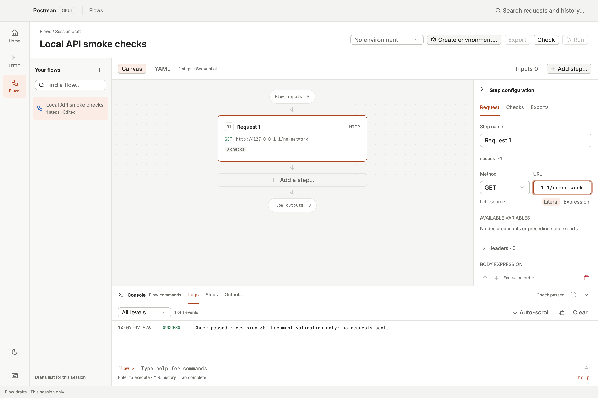
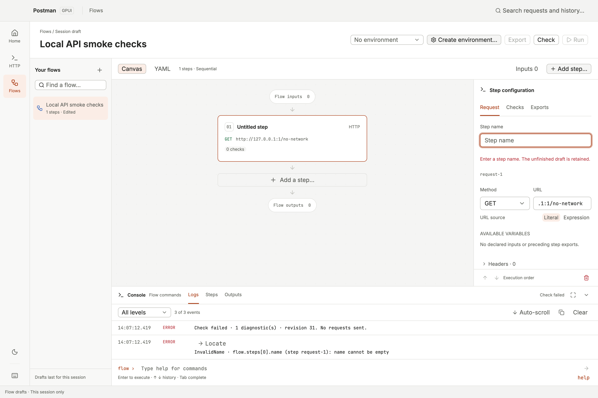
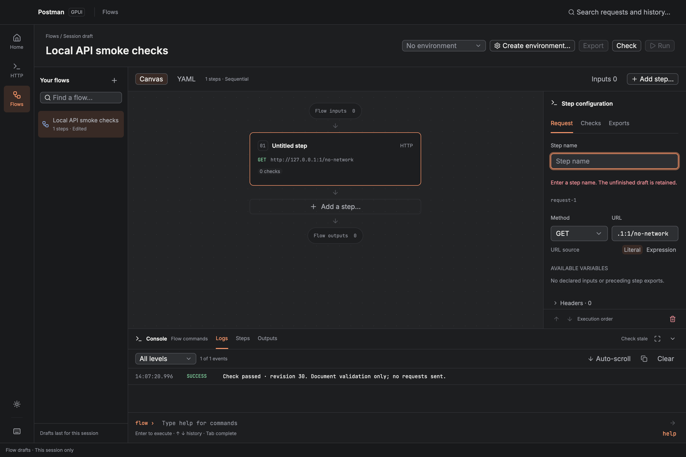
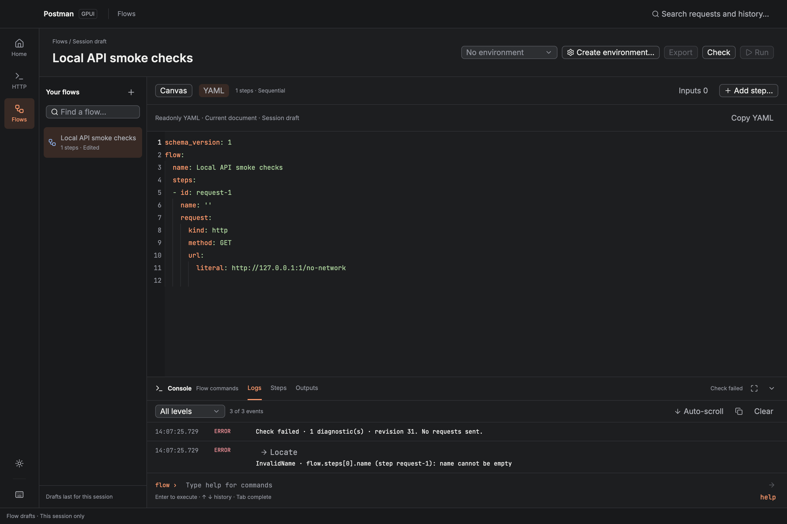

# P5.3-1 — Check and readonly YAML verification

Issue: #235. Parent: #194. Design baseline: `prototypes/request-workspace.html#flows`,
`flow-studio.js`, and `flow-studio.css`, building on merged PR #234 (`39bf913`).

## Automated interaction coverage

The production GPUI Kit views are exercised through buttons, command input, pointer scrolling,
clipboard operations, and keyboard activation. New coverage includes:

- Toolbar/Console compilation, focused edits, per-Flow results, stale results, and navigation.
- Hidden URL/header/body/condition/check/export/input-definition drafts; blank optional checks;
  recovery to the last valid value; runtime input errors and missing values excluded from Check.
- Diagnostic navigation from YAML/maximized Console, keyboard navigation to a readonly API owner,
  stale targets after reordering, and complete reports containing 520 errors.
- Readonly typing/paste/delete protection, exact native YAML copy, retained selection across
  views/Flows, rich API/loop/check/auth/options/default/output/layout round trips, and Add step
  returning to its editor from YAML.
- Stale last-applied previews, disabled Copy, native serialization failures and depth limits.
- Layout bounds and reachable controls in light/dark themes at 1×/2× across 1440×960, 1920×1080,
  1024×768, 768×720, and 1024×600.

Tests: `flows::validation::tests`, `flows::inputs::tests::check_ignores_runtime_errors_but_tracks_hidden_definition_errors_and_recovery`,
`flows::request_inspector::tests::definitions::check_collects_hidden_check_export_condition_and_expression_drafts`,
and `tests/ui_flows.rs`. Existing compiler/codec, editor, Console, transfer, persistence and HTTP
regressions are included in the workspace suite. Prototype model tests and an actual browser
interaction check cover its updated status/stale-preview presentation; its validator remains partial.

## Native visual evidence

The images below use the production `PostmanApp`, embedded fonts, GPUI Kit controls and the native
Metal renderer, with a 1440×960 logical viewport at 2× display scale. They are independent of the
automated layout assertions. Native Canvas/Console and YAML were also captured at the four smaller/
larger matrix sizes in both themes. Check uses a deliberately unreachable local URL and performs no
request. No live service results or environment values appear in these screenshots.

The native view follows the reference's panel hierarchy, spacing, muted status copy, accent keys,
and Console placement. Native Kit supplies line numbers, text selection and scrolling. Compact
windows retain both Canvas/YAML controls and the existing Canvas/Details action. API/loop and
unsupported DSL configuration remain readonly; the preview preserves them.

### Passed

### Failed with a location

### Stale after an edit

### Readonly source

## Scope boundary

Check/preview/copy do not execute requests, resolve run inputs, write files, or mark drafts saved.
Explicit sensitive document defaults remain in YAML. Save/export/reopen/unsaved-close protection
belong to the next P5.3 slice; real Run/Cancel/results remain P6. #194 stays open.
